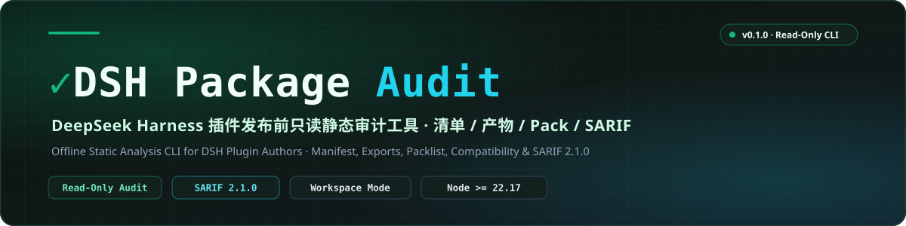

<p align="center">
  
</p>

<p align="center">
  <code>v0.1.0</code> · <code>Node.js &gt;= 22.17</code> · <code>JSON / SARIF 2.1.0 / Markdown / NDJSON</code> · <a href="LICENSE">MIT License</a>
</p>

<p align="center">
  <strong>English</strong> · <a href="README.zh.md">简体中文说明</a>
</p>

---

Read-only release checks for DeepSeek Harness plugin authors. This is an independent developer CLI, not an official validator or an installable DSH bundle. It does not load plugin code, install plugins or call a model API.

Requires Node.js 22.17 or later.

```sh
npm ci
node bin/audit.mjs /path/to/plugin
node bin/audit.mjs /path/to/plugin --json
npm test
npm run check
```

Exit codes: 0 for no errors, 1 for audit findings, 2 for invalid CLI arguments. An audit passing is not a security review or proof that the plugin runs.

Contract reference: [DeepSeek package manifest types](https://github.com/deepseek-ai/deepseek-harness/blob/fcc0ad462172522aaf5c93a7b2e01f6b9f0b0159/packages/util/package-manifest/src/types.ts), inspected 2026-11-07. DSH is evolving; unsupported declarations are reported conservatively.

Development was assisted by Codex. Tests and limitations are part of the repository so results can be reproduced.

To catch files that exist locally but are omitted from publication, run `npm pack --dry-run --json --ignore-scripts` in the plugin directory and save its JSON output outside that directory. Pass it with `--packlist /path/to/pack.json`. Build the plugin first: lifecycle scripts are deliberately not run by the audit. The report must match the package name and version; regenerate it after changes. A supplied report can be stale, so this is not a verification of an already-published tarball.

Generate pack reports only from code you trust: npm 10 may run `prepare` even with `--ignore-scripts`. The audit CLI only reads an existing report; it never invokes npm. The smoke test removes scripts from its controlled fixture before asking npm to pack it.

## Checks

Node export URLs are decoded before checking files, and invalid subpath/condition maps are rejected. Legacy `browser` file/replacement declarations are inspected, while dependency aliases remain explicitly unresolved. Bundle visibility must be boolean; repeated patch artifacts produce a warning.

Optional `screenshots.json` declarations are checked against the [community catalog format](https://github.com/awesome-dsh-plugin/awesome-dsh-plugin/blob/main/contributing.md#screenshots--截图optional-recommended--可选推荐): 1–8 local images or GitHub-hosted HTTPS URLs. Remote images are not fetched. Repository-only screenshots are inspected inputs, not required npm artifacts.

- Bundle metadata, single/ordered patch paths, bounded YAML parsing without executing `!!js`.
- Realpath-contained files, emitted main/types/bin/conditional export artifacts and client declaration types.
- Optional icon formats and the host's 256 KiB size limit.
- Packed-file presence using npm's own dry-run report, rather than guessing `files` whitelist semantics.
- `--dsh-version 0.2.2-rc.1` and `--platform win32`: explicit compatibility targets. `engines.dsh` overrides DSH peers, following the [host implementation](https://github.com/deepseek-ai/deepseek-harness/blob/fcc0ad462172522aaf5c93a7b2e01f6b9f0b0159/packages/boot/app-boot/src/plugin-compatibility.ts). Prereleases participate; supported workspace shortcuts apply only to peers.
- `--workspace`: npm workspace members with a `dsh` declaration; ordinary libraries are skipped. Member failures propagate to the process exit code.
- `--sarif`: SARIF 2.1.0 for CI consumers. `--fail-on-warning` makes advisory findings fail CI; notes do not fail it. Choose one of `--json`, `--sarif`, `--markdown` or `--ndjson`.

## Validation and limits

`npm run check` runs behavior tests and an offline release smoke test. It audits a good fixture, reproduces an omitted patch, checks that the audit does not run lifecycle scripts, then packs and installs the auditor into an isolated temporary directory. The installed CLI must produce JSON, SARIF, Markdown and NDJSON reports. CI covers the minimum supported Node 22.17.0 as well as current Node 22/24 on Windows and Linux; dependencies must already be in npm's cache (`npm ci` fills it). Development-only schema validation dependencies are excluded from the isolated installation.

Use `--markdown --output audit.md` to attach a summary to a PR, or `--json --output audit.json` / `--sarif --output audit.sarif` for automation. Reports are atomically written as UTF-8; existing audited inputs are protected from overwrite. The destination directory must exist. Raster icon checks recognize PNG/JPEG/WebP signatures; they do not fully decode images. Pack reports with differing local artifact sizes produce `pack.stale` warnings, not proof that an arbitrary report is authentic.

This CLI is not published to npm yet. Use this checkout. It does not model the full Cordis composer, profile compatibility exemptions or runtime behavior. Export wildcard artifacts are enumerated; fallback arrays remain explicitly unverified. Workspace discovery supports package.json arrays and `{ packages: [...] }`, including `!` exclusions. When npm workspaces are absent, it reads `packages` from [pnpm-workspace.yaml](https://pnpm.io/pnpm-workspace_yaml); pnpm catalogs/settings are not interpreted. Limits: manifest/patch/workspace YAML 1 MiB, pack report 8 MiB, 2000 workspace members. JSON reports include absolute local root paths; SARIF artifact locations are relative.

The audit checks every DSH-declaring workspace member as an installable bundle; internal client-only libraries may legitimately fail that contract. The minimal example is an inert packaging fixture, not an advertised plugin feature.

## Runtime targets, budgets and library use

`--node-version 22.17.0` checks `engines.node` against an explicit target; without a target, only the range syntax is checked. `--workspace --include-root` also audits the npm workspace's root as a plugin; pnpm already includes a DSH-declaring root. `--packlist pack.json --max-unpacked-size 5242880` enforces a per-package byte budget using the report's file sizes, which must all be present. SARIF results include stable fingerprints for deduplication across checkout locations.

When installed from a local checkout or tarball, these public ESM entry points are available (the package is not on npm yet):

```js
import { audit } from '@yokipan77/dsh-package-audit'
import { auditWorkspace } from '@yokipan77/dsh-package-audit/workspace'
import { toSarif, toMarkdown, toText, toNDJSON } from '@yokipan77/dsh-package-audit/reports'

const report = audit('/path/to/plugin', { nodeVersion: '22.17.0' })
console.log(toMarkdown(report))
```

Library calls return reports without setting process exit codes or writing report files. The release smoke test checks both CLI and public API imports from the isolated, installed tarball.

## Publication metadata and pipeline integration

`--publish-check` opts into npm publication metadata checks: `private`, `publishConfig.access/tag/registry` and script declaration shapes. Private workspace packages remain valid for ordinary local audits. Lifecycle script names are reported as notes; script bodies are never run or included in findings. This check does not contact a registry, verify ownership, or determine whether a version is already published.

`--platform linux --arch arm64 --libc musl` checks npm `os`/`cpu`/`libc` declarations, including exclusions such as `!win32`, using [npm-install-checks](https://github.com/npm/npm-install-checks). The platform target also checks `dsh.bundle.platforms`. `--libc` requires `--platform linux`; unspecified dimensions are not inferred from the auditor's machine. Native binary compatibility is outside this check. API equivalents are `{ platform: 'linux', arch: 'arm64', libc: 'musl', publishCheck: true }`.

`--packlist -` reads an existing UTF-8 npm pack report from standard input, bounded to 8 MiB. For example, `node bin/audit.mjs ../plugin --packlist - --json < ../pack.json` in a POSIX shell or cmd.exe; PowerShell users can use `Get-Content -Raw -Encoding utf8 ../pack.json | node bin/audit.mjs ../plugin --packlist - --json`. The API can receive the same JSON text as `packlistContent`.

`--ndjson` emits one JSON object per line. A single-package audit produces a `type: "package"` record containing the complete package report. A workspace emits a `type: "workspace"` summary with `packageCount`, followed by package records in deterministic path order. Newlines inside strings remain escaped. Audit results are collected before serialization; this mode does not stream the filesystem scan. Like JSON, records include absolute local roots.

Standard `--json` reports use `schemaVersion: 1`. The Draft 7 schema at [`schemas/report-v1.schema.json`](schemas/report-v1.schema.json) covers successful and failed package/workspace reports, including nullable package names. Consumers can import it with `import schema from '@yokipan77/dsh-package-audit/schema' with { type: 'json' }`. The schema describes the standard JSON report, not SARIF or the NDJSON record wrappers.

Workspace reports also record inspected member manifests in `references`, including ordinary libraries skipped by DSH validation. `--output` protects those inputs too. Directory aliases are deduplicated by their real package directory; a manifest file link does not change its package root. Workspace names may contain literal double dots, while parent path segments remain forbidden.

## Additional artifact and metadata checks

- Local [Node `imports`](https://nodejs.org/api/packages.html#subpath-imports) targets are checked like exports, including conditions and wildcard artifacts. External package mappings and fallback arrays produce unresolved notes; modules are never loaded.
- [TypeScript `typesVersions`](https://www.typescriptlang.org/docs/handbook/declaration-files/publishing.html#version-selection-with-typesversions) ranges and mapping shapes are validated. Explicit declaration filenames and wildcard artifacts enter file/pack checks. Alternative targets, extension substitution and directory resolution remain explicitly unverified; no compiler version is selected.
- Export/import nesting is limited to 64 levels. Wildcard artifact traversal stops after 20000 directory entries while reading, excludes `.git`/`node_modules`, skips directories as artifact matches and does not descend into directory links. This limit applies per wildcard declaration, not to workspace glob discovery.
- SVG icons within 256 KiB receive XML well-formedness and root/namespace checks using [saxes](https://github.com/lddubeau/saxes). DTDs and custom entities remain unresolved; no external entities are fetched. This is not rendering or SVG sanitization. Raster checks still inspect file signatures only.
- Dependency maps, package names, npm specifier syntax and peer optional flags are checked with [npm-package-arg](https://github.com/npm/npm-package-arg). Registry ranges/tags/aliases are parsed without fetching them. Workspace, link and catalog references, plus file/Git/remote sources, produce unresolved notes. No dependency is installed and credentials in specifier values are not included in diagnostics. Protocol recognition does not validate workspace/catalog configuration.
